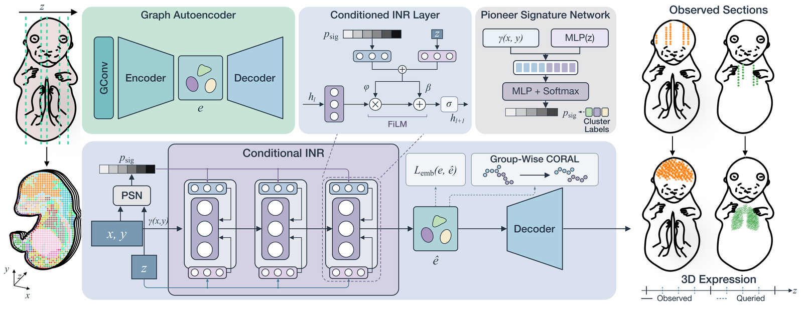

# HoloGene: Learning to Lift Sliced Spatial Transcriptomics to Holistic 3D Gene Fields

Official implementation of **HoloGene** (NeurIPS 2026).

HoloGene is an anisotropic conditional implicit neural representation that estimates a continuous
3D gene-expression field from pre-registered serial spatial-transcriptomics sections. A graph
autoencoder (GAE) compresses expression into latent targets, a Pioneer Signature Network (PSN)
provides coarse signature guidance, and a FiLM-conditioned INR synthesizes the latent field from
in-plane coordinates modulated by depth, regularized with signature-stratified CORAL.



## Installation

```bash
git clone https://github.com/Szym29/HoloGene.git && cd HoloGene
conda env create -f environment.yml
conda activate hologene
```

## Data

HoloGene takes one `.h5ad` file with all sections in a common registered coordinate system:

| field | content |
|---|---|
| `X` | expression matrix (spots × genes) |
| `obsm['spatial']` | registered 3D coordinates (z identifies the section) |
| `obs['leiden']` | pseudo-labels for PSN / CORAL |
| `obs['annotation']` | annotation, used only for evaluation |

MOSTA E16.5 data are available from the [MOSTA database](https://db.cngb.org/stomics/mosta/).
The preprocessed file used in the paper can be downloaded from
[Zenodo](https://doi.org/10.5281/zenodo.24259532); place it at
`data/mosta/E16.5_10percent_noCavity_coor_leiden_hologene_full_top3000.h5ad`.

## Usage

```bash
# 1) pretrain the GAE on the training sections
python pretrain_gae.py --config configs/gae.yaml
# 2) train HoloGene and predict the held-out sections
python train.py --config configs/hologene.yaml
# 3) evaluate
python evaluate.py --prediction outputs/mosta/split_8to2/hologene_full/prediction.h5ad \
                   --out-dir outputs/mosta/split_8to2/hologene_full/eval
```

`evaluate.py` reports masked MSE, masked Cosine, Pearson, masked Spearman, Pathway F1, CCC Pearson,
CCC Top-F1 and DEG F1 (`--skip-biology` for reconstruction metrics only).
Pathway F1 is computed with the [g:Profiler](https://biit.cs.ut.ee/gprofiler/) API; the paper used
database version `e114_eg62_p19_9dc92ac8`.

Query the trained field at arbitrary coordinates, e.g. between two measured sections:

```python
from hologene.inference import load_hologene, query
model, info = load_hologene("outputs/mosta/split_8to2/hologene_full/hologene.pt")
expression, latent = query(model, info, xyz)   # xyz: raw registered coordinates, shape (N, 3)
```

## Citation

```bibtex
@inproceedings{zheng2026hologene,
  title     = {HoloGene: Learning to Lift Sliced Spatial Transcriptomics to Holistic 3D Gene Fields},
  author    = {Zheng, Yumin and Zhu, Qingtian and Zhu, Ziyan and Song, Kailu and Zheng, Yinqiang and Ding, Jun},
  booktitle = {Advances in Neural Information Processing Systems},
  year      = {2026}
}
```
